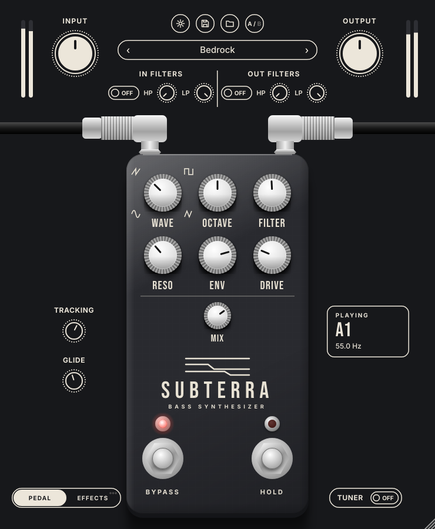
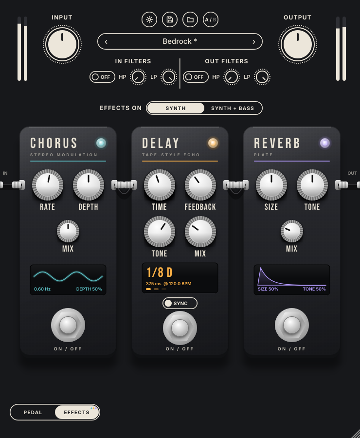

# Subterra

A bass synthesizer pedal as a VST3 / AU plugin. Plug a bass in and play: Subterra tracks the pitch and
dynamics of each note and plays a synth voice along with it, blended with your dry bass.

| Pedal | Effects |
| --- | --- |
|  |  |

## Controls

Every control on the UI is a real, automatable parameter.

| Control | What it does |
| --- | --- |
| **Wave** | Oscillator shape, a continuous morph from sine to saw to square to triangle (the icons around the knob). |
| **Octave** | Synth pitch relative to the note you play: -2, -1, 0, +1, +2 octaves. |
| **Filter** | Cutoff of the synth's resonant low-pass filter (40 Hz to 12 kHz). |
| **Reso** | Filter resonance. |
| **Env** | How far your picking dynamics sweep the filter. Right of centre opens it as you dig in, left closes it. |
| **Drive** | Saturation on the synth voice. |
| **Mix** | Balance between your dry bass and the synth (equal-power). |
| **Bypass** footswitch | True bypass with a click-free crossfade. The left LED is lit when the pedal is on. Also the host's bypass. |
| **Hold** footswitch | Freezes the current synth note so it drones on after you stop playing. The right LED shows Hold. |
| **Input / Output** | Gain into the pedal and final level, ±24 dB, with stereo peak meters. |
| **In Filters** | High- and low-pass on the bass before the pedal (also cleans up what the tracker hears). OFF/ON switch. |
| **Out Filters** | High- and low-pass on the final output. OFF/ON switch. |
| **Tracking** | Sensitivity: how quietly you can play and still trigger the synth. |
| **Glide** | Portamento between legato notes (off to 1 s). Notes that start from silence always land on pitch. |
| **Playing** readout | The note and frequency you are playing. |
| **Tuner** | Turns the readout into a tuner (note, cents and a needle) and mutes the output. Muting and the A4 reference are in Settings. |
| **Presets** | ‹ › step through presets; click the name or the folder button to open the preset browser (14 factory sounds, your own below them, each with a delete button that moves the file to the Trash). The save button names and stores the current sound, and warns before replacing one. A `*` means the sound was edited. |
| **A/B** | Click to switch between two complete settings to compare them. Right-click to copy one to the other. |
| **Settings** | Tuner reference (A4 = 432 to 446 Hz), mute while tuning, window size, copy A/B, reset to Init. |
| **PEDAL / EFFECTS** | Slides between the pedal and the effects page. Dots on EFFECTS show which effects are on. |

### Effects

Three effects in a fixed chain after the synth: chorus, then delay, then reverb. Each has a footswitch and LED,
and its own display.

| Control | What it does |
| --- | --- |
| **Effects on** | **Synth**: only the synth goes through the effects and your bass stays dry and tight. **Synth + Bass**: everything goes through them. |
| **Chorus** Rate / Depth / Mix | Two-voice stereo chorus; the display shows the sweep moving at the Rate. |
| **Delay** Time / Feedback / Tone / Mix | Tape-style echo up to 2.5 s with darkening repeats. Changing the time glides like tape instead of clicking. |
| **Delay** SYNC / FREE | Sync sets the time in note values (1/16 to 1/2, with dotted and triplet) from the host tempo; the display shows the resulting milliseconds. Free uses the Time knob in ms. |
| **Reverb** Size / Tone / Mix | Plate reverb; the display shows the decay. |

Switching delay or reverb off lets the repeats and tail ring out (trails), as on a pedalboard.

Knobs: drag up/down, mouse wheel, double-click to reset. Hover for a description, and the value shows while you drag.
The window can be resized from the corner.

## How it works

- **Pitch**: the input is low-passed, decimated to about 8 kHz and analysed with the YIN algorithm every ~6 ms,
  with a median filter against octave slips. It tracks B0 (31 Hz) to 1 kHz to within a fraction of a cent and
  locks onto a low E in about 65 ms.
- **Dynamics**: a two-pole mean-square follower gives a smooth level that drives the synth's volume and the
  filter envelope, so the synth breathes with your playing.
- **Voice**: band-limited (PolyBLEP) morphing oscillator, tanh drive, and a zero-delay-feedback state-variable
  low-pass filter.
- **Gate**: the synth starts above the Tracking threshold and stops when the note falls back below it, or 40 dB
  under its peak, so hum under a dying note doesn't keep it droning.
- **Effects**: modulated delay-line chorus, a cubic-interpolated stereo echo with a filtered, soft-limited
  feedback path, and a Freeverb-based plate.
- **Host friendly**: every change is smoothed (no clicks or zipper noise), the sound is identical at any buffer
  size, audio runs in fixed 256-sample chunks with no allocation, and it uses under 2% of one core with
  everything on.

Source layout: `source/dsp` (tracker, voice), `source/PluginProcessor.*` (signal flow), `source/Presets.*`,
`source/PluginEditor.*` and `source/ui` (the interface), `tests/` (engine tests), `tools/Snapshot.cpp`
(UI screenshot and control check).

## Building

Requires CMake 3.22+ and a C++20 compiler. JUCE 8 is fetched automatically (or pass `-DJUCE_DIR=/path/to/JUCE`).

```sh
cmake -S . -B build -DCMAKE_BUILD_TYPE=Release
cmake --build build --config Release
./build/SubterraTests_artefacts/Release/SubterraTests   # 320 engine checks
```

macOS builds VST3, AU and a standalone app; Windows and Linux build VST3 and standalone.

GitHub Actions builds all three platforms on every push, runs the engine tests, checks every UI control,
and validates the plugins with [pluginval](https://github.com/Tracktion/pluginval) at its strictest level
(plus `auval` for the Audio Unit). Download the builds from the run's **Artifacts**: on a Mac, run `Subterra-macOS-Installer.pkg`. Pushing a tag such as
`v0.1.0` also publishes them as a GitHub release.

## Licence notes

Built with [JUCE](https://juce.com) 8. Using JUCE requires either a JUCE licence or releasing under the AGPLv3,
so choose a licence before distributing builds. Fonts: Bebas Neue and Inter, both under the SIL Open Font
Licence (see `resources/fonts`).
